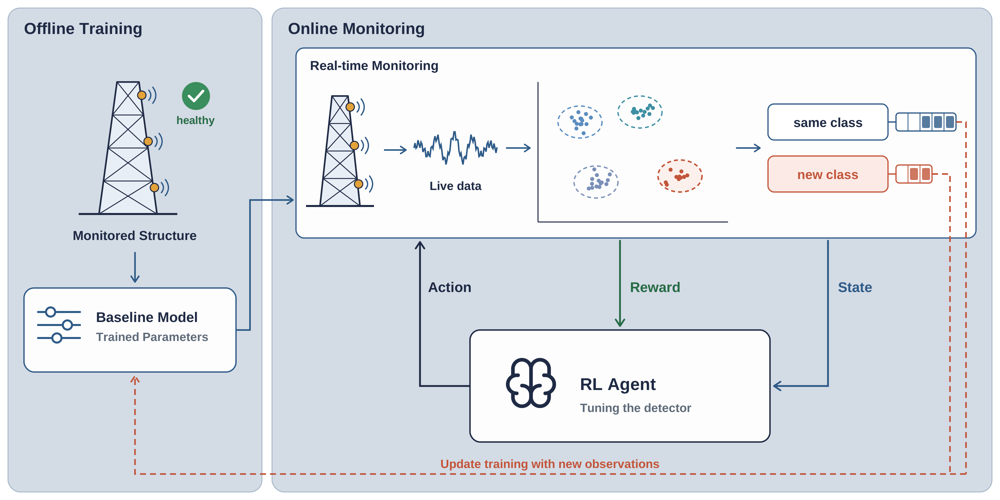

Civil infrastructure such as wind turbines, bridges, and buildings operates under constantly changing environmental and operational conditions, which makes vibration based damage detection challenging. Most detection pipelines depend on a few manually tuned parameters, and settings chosen offline for one structure or condition often fail to transfer, leading to false alarms, missed detections, or spurious classes.

The underlying detector is a semi-supervised, open set framework that extracts damage sensitive features from acceleration signals, projects them with Linear Discriminant Analysis, and scores new observations with Probabilistic Linear Discriminant Analysis. Extreme value thresholds allow the model to assign data to known classes or create new classes when unseen conditions such as damage appear. A sensitivity analysis showed that performance depends strongly on these parameters and their interactions, so they cannot be tuned one at a time.

This study casts parameter tuning as a sequential decision problem and introduces a reinforcement learning agent that adjusts key parameters in real time based on indicators of classifier behavior, replacing one shot offline calibration with a continuous closed loop process.

The framework is demonstrated on a wind turbine case study, trained only on healthy data and tested on unseen healthy and damaged conditions. It reliably distinguishes damaged from undamaged states and identifies distinct health conditions without manual parameter selection.



<!-- Graphical abstract placeholder: replace with the final figure when available -->

  

